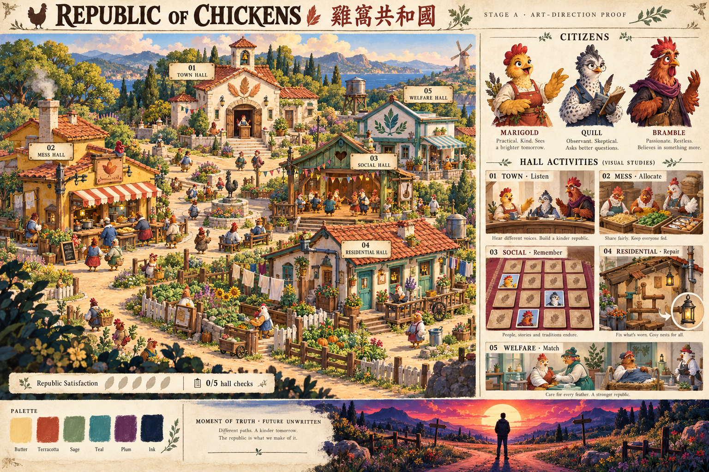

# Republic of Chickens · 雞窩共和國

## Stage A: art-direction review

The illustration below is the proposed art direction, awaiting approval before game implementation. It shows the connected republic, the three recurring citizens, all five hall activities and the sunset crossroads.

[Open the full-resolution illustration](art-direction/republic-of-chickens-stage-a.png) · [Read the art-direction brief](art-direction/STAGE-A.md)

Small decorative captions in the concept sheet are placeholders. The GDD's exact ending text and deliberately unresolved outcome remain authoritative. The Traditional Chinese game title is **雞窩共和國**, as specified by the user.

## Design handoff

- [Game design document v1.0](handoff/Republic_of_Chickens_Codex_Handoff_v1.0/GDD.md)
- [Original handoff instructions](handoff/Republic_of_Chickens_Codex_Handoff_v1.0/README-CODEX.md)
- [Supplied sunset composition reference](handoff/Republic_of_Chickens_Codex_Handoff_v1.0/ending-crossroads-reference.png)

This checkpoint contains concept art and design documentation. Game implementation follows art-direction approval. Public deployment requires separate authorization.
