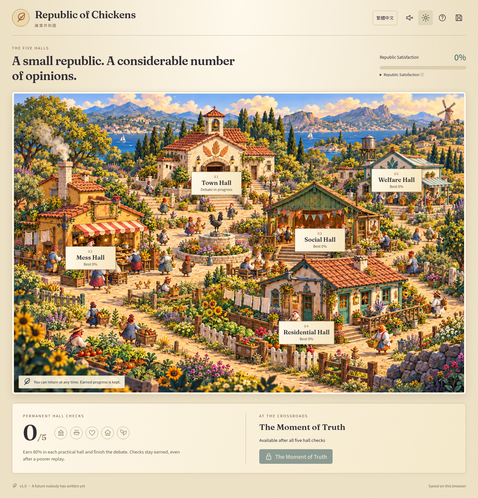

# Republic of Chickens · 雞窩共和國

A bilingual, illustrated browser game about caring for a small republic and listening to its rather opinionated chickens. Five playable halls, permanent milestones, and a future that remains deliberately unwritten.

**v1.0 is prepared for local play. Public deployment is not enabled.** Stage A was approved at `35c4298`.

[Download the prebuilt game](release/republic-of-chickens-v1.0.zip) · [Test results](docs/TEST-RESULTS.md) · [Gameplay screenshots](docs/SCREENSHOTS.md) · [Visual compromises and limitations](docs/VISUAL-AND-RELEASE-NOTES.md)



## Play the prebuilt release

Download and **extract** [the ZIP](release/republic-of-chickens-v1.0.zip). Open a terminal in the extracted folder and run:

```sh
python3 play.py
```

On Windows, `py play.py` also works. Open the local address printed by the launcher. Stop it with Ctrl+C. Python 3 is the only launcher requirement; the game itself needs no Node installation, accounts, backend, or external services. Any ordinary static HTTP server can serve the extracted folder. Double-clicking `index.html` with `file://` is not supported.

中文：完整解壓縮後，在該資料夾執行 `python3 play.py`（Windows 可用 `py play.py`），再以瀏覽器開啟終端機印出的本機位址。

Use **Save & backup / 存檔與備份** to export progress before changing browsers, devices, ports, or site addresses. Autosaves belong to the browser and origin; language and ending choices never reset the republic.

## Develop and validate

Use Node.js 24 LTS and npm. Python 3 is needed only to package or launch the prebuilt release.

```sh
npm ci
npm run dev
```

```sh
npm test                 # 29 logic and content checks
npm run build           # TypeScript check + static production build in dist/
npm run test:browser     # Desktop and phone-emulated Chromium
npm run release          # Build + ZIP and SHA-256 checksum in release/
```

`npm run check` runs the logic tests, build, and browser suite together. The browser tests use system Chromium when present. Otherwise install Playwright's browser with `npx playwright install --with-deps chromium`, or set `CHROMIUM_PATH` to a browser executable. The CI workflow validates and uploads artifacts; it contains no Pages deployment job.

[Reusable cloud setup and startup guidance](docs/CLOUD-ENVIRONMENT.md) is also saved as an environment configuration draft.

To recapture gameplay screenshots, first run `npm run preview -- --port 4173`, then run `npm run screenshots` in another terminal. The capture script actually earns all five hall checks before showing the crossroads. It does not bypass game progression.

## Five halls

| Hall | Activity | Permanent check |
| --- | --- | --- |
| Town Hall / 公民議事廳 | A 42-exchange authored debate; resume/replay, auto-play/pause, previous/next and transcript | Reach the final exchange or scroll to the transcript's end |
| Mess Hall / 伙食廳 | Finite, solvable food allocation with separate fullness and dietary scoring | At least 80% |
| Social Hall / 聯誼廳 | Shuffled 4×4 memory matching with eight portrait pairs and a player-triggered three-second preview | Finish in at most 16 attempts |
| Residential Hall / 住宅廳 | Ten illustrated trouble spots with two-step repairs, saved progress, hints and issue list | At least eight repairs |
| Welfare Hall / 照護廳 | Five patient/treatment matches; drag, tap or keyboard | At least four first-try matches |

Satisfaction is the mean of the four latest completed practical scores, with unplayed halls counting as zero. Best scores and earned checks are separate; a poorer replay can lower satisfaction but never revoke a check. There is no background decay or resource grind.

All five checks unlock the optional Moment of Truth. Both choices preserve the unresolved ending and return to continued play. The choice can be revisited.

## Handoff and release information

- [GDD v1.0](handoff/Republic_of_Chickens_Codex_Handoff_v1.0/GDD.md) and [original instructions](handoff/Republic_of_Chickens_Codex_Handoff_v1.0/README-CODEX.md), unchanged.
- [Approved Stage A artwork](art-direction/republic-of-chickens-stage-a.png) and [art brief](art-direction/STAGE-A.md).
- [Test report](docs/TEST-RESULTS.md), [actual gameplay screenshots](docs/SCREENSHOTS.md), and [visual/release notes](docs/VISUAL-AND-RELEASE-NOTES.md).
- [Asset and font notices](docs/THIRD-PARTY-NOTICES.md), including the GDD's quotation-review requirement before commercial release.
- [GitHub Pages preparation](docs/GITHUB-PAGES.md), for use only after explicit deployment authorization.
- [Release checksum](release/SHA256SUMS.txt).

The Traditional Chinese title is **雞窩共和國**, overriding any alternate title. The current GitHub repository retains its existing `reppublic-of-chickens` spelling.
