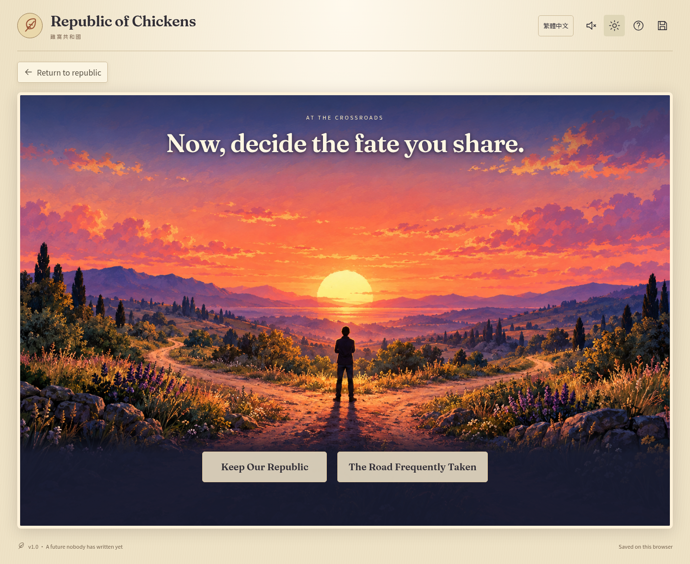

# Actual v1.0 gameplay

These images were captured from the running production build using `npm run screenshots`. The script plays the five halls to earn the crossroads unlock, then transfers that progress using the real confirmed backup-import interface for phone captures. No concept sheet is presented as implemented gameplay.

| View | Desktop · English | Phone emulation · Traditional Chinese |
| --- | --- | --- |
| Republic overview | [Overview](screenshots/overview-desktop.png) | [雞窩共和國](screenshots/overview-phone-zh-TW.png) |
| Town Hall | [Debate](screenshots/town-desktop.png) | [公民議事廳](screenshots/town-phone-zh-TW.png) |
| Mess Hall | [Meal allocation and result](screenshots/mess-desktop.png) | [伙食廳](screenshots/mess-phone-zh-TW.png) |
| Social Hall | [4×4 preview](screenshots/social-desktop.png) | [聯誼廳](screenshots/social-phone-zh-TW.png) |
| Residential Hall | [Eight repaired objects](screenshots/residential-desktop.png) | [住宅廳](screenshots/residential-phone-zh-TW.png) |
| Welfare Hall | [Patient and treatment matching](screenshots/welfare-desktop.png) | [照護廳](screenshots/welfare-phone-zh-TW.png) |
| Moment of Truth | [The two choices](screenshots/crossroads-desktop.png) | [岔路口](screenshots/crossroads-phone-zh-TW.png) |

[Five checks earned](screenshots/republic-complete-desktop.png) · [Selected Governor line and epilogue](screenshots/epilogue-desktop.png)

See [visual compromises and limitations](VISUAL-AND-RELEASE-NOTES.md) for the differences from the approved concept benchmark.
